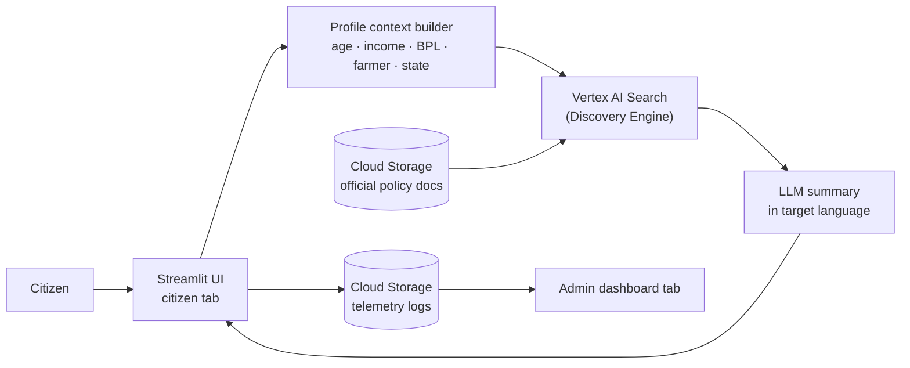

<div align="center">

# 🌉 Yojana Setu

### Conversational welfare scheme discovery for Indian citizens, in their own language

[](https://yojana-setu-app-998000871186.us-central1.run.app/)


Built as part of **GenAI Academy APAC Edition**

</div>

---

## The problem

India has 700+ welfare schemes across central and state governments. Millions of citizens qualify for some of them and never apply, because:

- eligibility rules are complex
- information is spread across separate government portals
- the material is often not in their language
- digital literacy is low
- nobody gives personalised guidance

Yojana Setu takes a plain-language question, checks it against the official eligibility rules, and answers in the user's language.

## Features

| | |
|---|---|
| **Grounded scheme discovery** | Vertex AI Search (Discovery Engine) retrieves official policy documents stored in Cloud Storage and generates a summary from them, so answers come from the source documents. |
| **Profile-aware eligibility** | Captures age, gender, income, BPL status, farmer status and state, and merges them with the conversational query before retrieval. |
| **Automatic language routing** | Detects the user's Indian state and sets the default answer language: Hindi, Marathi, Kannada, Tamil or English. |
| **Clean conversational UI** | Streamlit interface with session-state managed refresh, quick-action scheme shortcuts and a dark mode toggle. |
| **Admin dashboard** | Tracks anonymised citizen demand: total queries, eligibility rate, top schemes, state-wise usage and language distribution. |

## Architecture



### Why this stack

- **Decoupled:** policy documents can be updated without code changes
- **Serverless:** scales automatically, zero cost when idle
- **Pay per use:** fits a public-sector budget

## Tech stack

| Area | Tools |
|---|---|
| Cloud & AI | Cloud Run (hosting), Cloud Storage (policy documents + telemetry logs), Vertex AI Agent Builder (semantic indexing), Vertex AI Search summarizer (answer generation + translation) |
| Application | Python, Streamlit, Docker |

## Run it

<details>
<summary><b>Local setup</b></summary>

<br>

```bash
git clone https://github.com/Pradyumna047/yojana-setu.git
cd yojana-setu
pip install -r requirements.txt
streamlit run app.py
```

</details>

<details>
<summary><b>Deploy to Cloud Run</b></summary>

<br>

```bash
gcloud builds submit --tag gcr.io/<project-id>/yojana-setu

gcloud run deploy yojana-setu \
  --image gcr.io/<project-id>/yojana-setu \
  --platform managed \
  --region asia-south1 \
  --allow-unauthenticated
```

</details>

## Current limitations

- State detection uses an IP geolocation lookup. Outside India, or if the lookup fails, the app falls back to English.
- The dashboard's eligibility rate is a heuristic: an answer counts as "not eligible" when it contains phrases such as "not eligible" or "unable to find".

## Roadmap

- [ ] Hybrid UI (HTML + JS frontend, Streamlit backend)
- [ ] Scheme browser page
- [ ] Eligibility scoring engine
- [ ] Mobile-friendly UI
- [ ] Offline mode (local LLM)

---

<div align="center">

**Pradyumna Shetty** · GenAI Academy APAC Edition · [LinkedIn](https://www.linkedin.com/in/pradyumna-shetty-534a14132/) · [Portfolio](https://portfolio-gamma-teal-22.vercel.app)

</div>
